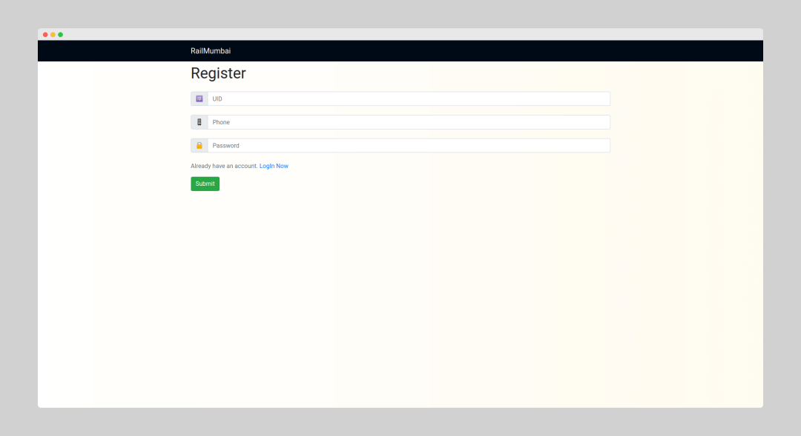
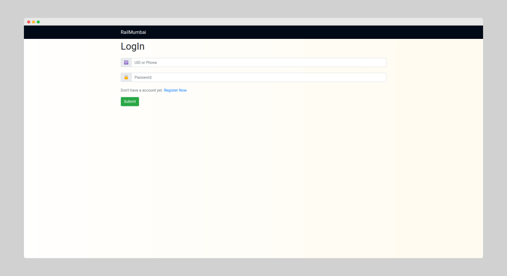
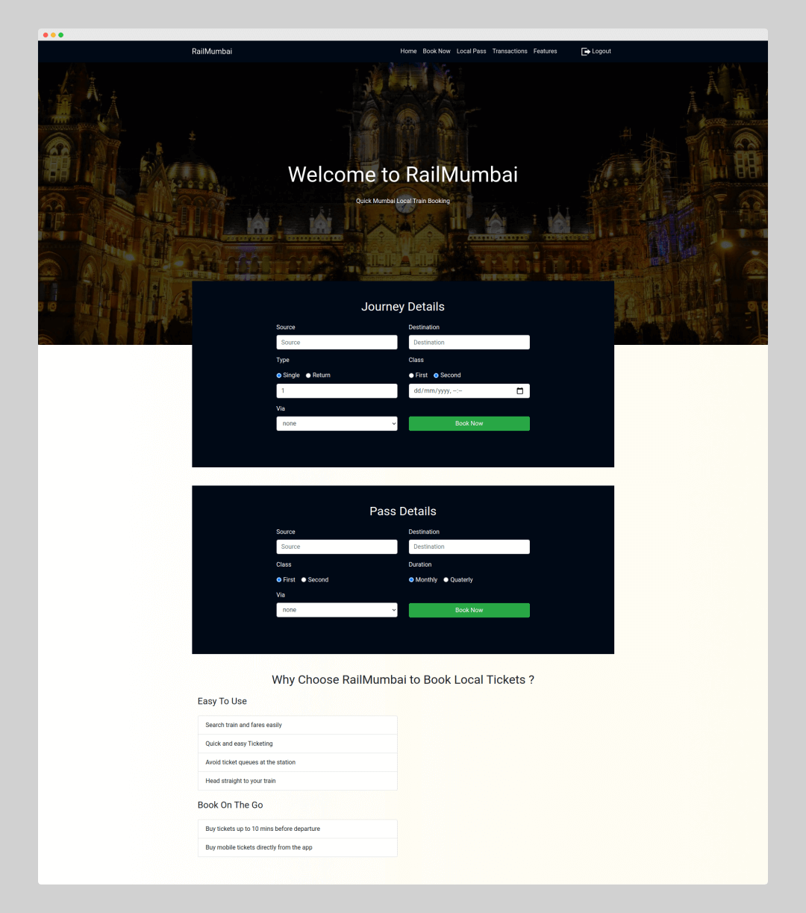
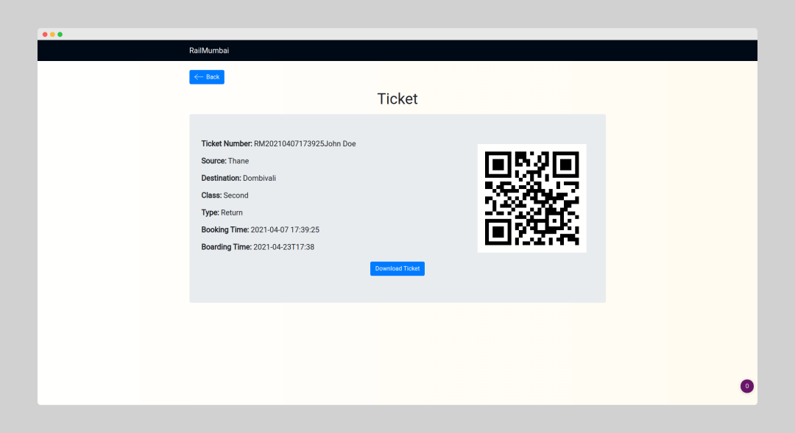

## Railway Ticket Management System

Simple Railway Ticket Management System with [Razorpay](https://razorpay.com) Payment Gateway in PHP/MySQL

### Local Setup

Requirements: PHP 7.4+ with the `mysqli` and `gd` extensions, MySQL 8, and a [Razorpay](https://razorpay.com) account (test mode keys are enough).

1. Create the database and user that `db/conn.php` expects:

   ```sql
   CREATE DATABASE railway;
   CREATE USER 'railway'@'localhost' IDENTIFIED BY 'easypassword';
   GRANT ALL PRIVILEGES ON railway.* TO 'railway'@'localhost';
   ```

2. Import the schema and demo data:

   ```bash
   mysql -u railway -p railway < railway.sql
   ```

3. Copy the config template and add your Razorpay key ID, key secret, and display currency (for example `INR`):

   ```bash
   cp config.sample.php config.php
   ```

4. Make sure the `temp/` folder is writable by the web server. Ticket QR codes are generated there.

5. Serve the project root with Apache, or run PHP's built-in server:

   ```bash
   php -S localhost:8000
   ```

   Then open `http://localhost:8000` and log in with one of the accounts below.

### Test User Login: 
	- UID: test
	- Password: easypassword

### Admin Login: 
	- UID: admin
	- Password: admin

### Screenshots 







